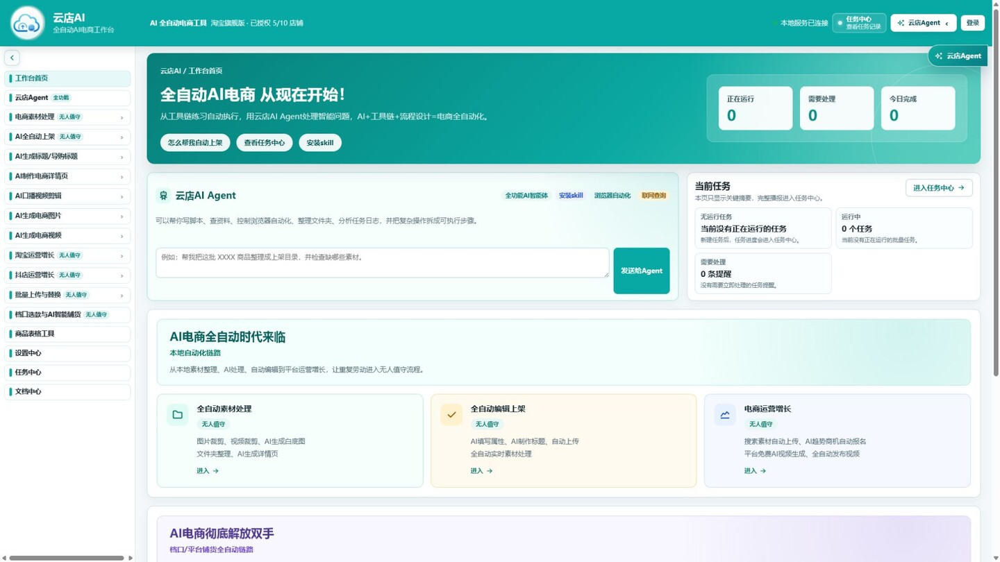
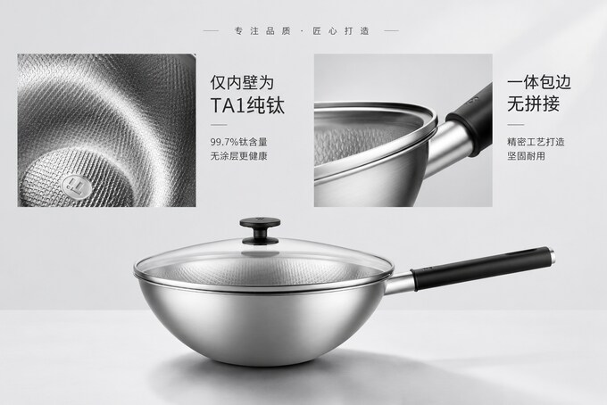
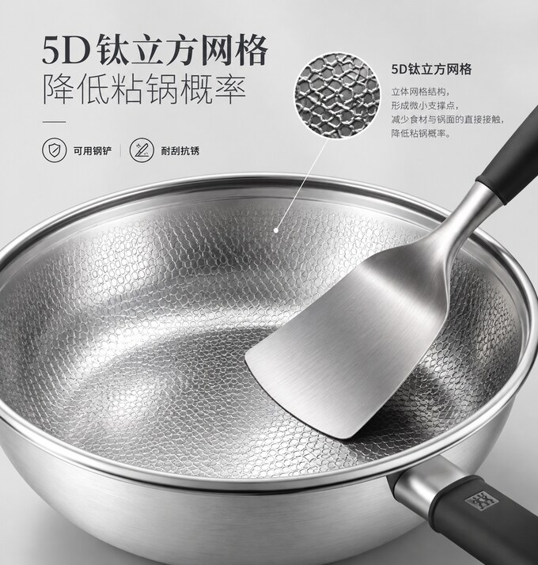

# Yundian AI · E-commerce Automation for Windows

[简体中文](README.md) · [English](README.en.md)

Yundian AI helps online merchants **source products, prepare assets, generate images and videos, manage listings, and run store operations** in one Windows app. Yundian Agent and MCP can connect the steps from preparing files to running tasks and checking results.

**[Official download center](https://www.ai-yundian.com/download)** · **[Free GitHub download](https://github.com/zhou293130/yundian-ai-downloads/releases/tag/v1.0.7)** · [Official feature overview](https://www.ai-yundian.com/features) · [Video guides in Chinese](https://www.ai-yundian.com/tutorials)

**The free plan costs ¥0 per term and includes access to all product features.** Usage quotas vary by plan. See your Account Center for current limits.

## Find a tool for the work you do

| Goal | What you can do |
| --- | --- |
| [Write titles and create product photos](#product-images) | Generate titles, white-background images, try-on images, and lifestyle photos in batches. |
| [Build product detail pages](#product-details) | Plan layouts, generate a set of product images, and refine individual images. |
| [Generate and edit short videos](#product-video) | Turn images into videos, adapt references, use templates, and batch-edit product videos with voiceovers and captions. |
| [List products or edit your catalog](#product-listing) | List from local files and update existing items in bulk on Taobao, Tmall, and Douyin Shop. |
| [Run store operations](#store-operations) | Upload search and recommendation assets, submit eligible products for marketplace opportunities, and publish videos. |
| [Organize product assets and spreadsheets](#asset-tools) | Batch-crop, extract video frames, upload and link videos, replace images, and clean up SKU tables. |
| [Source and distribute products](#product-sourcing) | Collect supplier product codes, images, prices, and listing details from Xingzuo, Xingqinglian, and Soukuan. |
| [Delegate tasks and manage stores](#agent-and-tasks) | Use Yundian Agent, MCP, task templates, run history, and store and team management. |

## AI product titles and product photography

- **Generate listing titles and short titles in bulk.** Use product images, categories, existing titles, and keyword rules. Check length and sync results by product ID. Includes general and women's apparel workflows.
- **Create product images.** Generate main images, white backgrounds, lifestyle sets, studio-style images, and apparel shots. Change the background, pose, or composition according to the task.
- **Use reference shots and virtual try-on.** Use your own product images with a reference for lighting, scenery, or styling. Generate photos in batches in the cloud, or create ads and posters from text and reference images. Download the results, reuse them as references, or use them in supported listing and editing workflows.

| Original photo | AI studio photo of the same product |
| --- | --- |
|  |  |

## AI product detail page generation

- **Plan a full detail page.** Turn product images and factual details into selling points, copy, image concepts, and a sequence for the page.
- **Refine individual images or process a batch.** Review the plan, revise the style, regenerate one image, or mark a specific area to edit. Organize results by product and upload them through supported workflows.

| Cookware example · Construction | Cookware example · Surface texture |
| --- | --- |
|  |  |

## AI product videos, voiceovers, and batch editing

- **Generate video from text, images, or supported references.** Define start and end frames, adapt a reference clip, replace the featured product, use a motion reference, or describe a video edit.
- **Make videos from templates.** Preview an example, choose a style, and supply your own product information and media. Reuse suggested shot descriptions and parameters.
- **Make narrated clips and edit batches.** Generate or reuse scripts, add voiceover, captions, covers, and music, then produce one or more videos per product. Batch editing can run locally or in the cloud.

## Automated listing on Taobao, Tmall, and Douyin Shop

- **List from local product folders.** Match main images, detailed descriptions, videos, categories, and SKUs. Prepare content and fill in variants, prices, inventory, and fulfillment fields. Submit to a supported status and record each result.
- **Apply multiple category rules in a Douyin Shop batch.** Store category attributes and SKU rules in one template and apply them by product category.
- **Edit and publish fully managed TikTok Shop products via Miaoshou.** Localize titles and detail images, organize variants, set JIT or standard inventory options, add weight, package dimensions, and available compliance materials, then save or publish selected items.

### Bulk editing and catalog updates

Select products and update their titles, attributes, main images, product details, videos, size charts, SKUs, prices, stock, or shipping information as supported by the marketplace workflow. Taobao and Tmall can check and repair specified text in main images. Douyin Shop supports saving drafts, taking down items, and putting items on sale where available.

## Store operations and video publishing

- **Upload Taobao search and recommendation assets.** Match images and videos to products that need more assets and check the status of each placement. Track publicly visible catalog changes at selected stores.
- **Find and submit marketplace opportunities.** Collect visible trend terms from Taobao and Douyin, then submit eligible products using supported match, category, and filter rules.
- **Generate and publish videos.** Use supported Taobao Business Manager, Guanghe, and Douyin Shop tools to create, edit, download, or publish product videos. Douyin Shop supports direct publishing and spreadsheet-based product matching for pre-review.

## Batch asset tools and product spreadsheet cleanup

- **Prepare images and folders.** Process local assets in batches, crop square and vertical images, extract candidate main images from videos, organize product folders, and apply detail-page templates. AI image review can check for specified text, tags, or ads and apply targeted corrections.
- **Download, upload, and link videos.** Download available videos in batches from Douyin or Xiaohongshu share links and organize them by product. Upload to Taobao or Douyin Shop, collect Taobao video IDs, or link videos to Douyin Shop products using a spreadsheet.
- **Replace listing images in bulk.** Use Miaoshou for Taobao main images and Douyin Shop main and detail images, and Super Store Manager for Taobao detail images.
- **Clean up product sheets and SKU data.** Organize titles, prices, codes, brands, and SKU tables into import files, review lists, or video operations records. Taobao workflows can also prepare promotional SKUs and record when original values are restored.

## Product sourcing and bulk distribution

- **Xingzuo and Xingqinglian.** Filter supplier products by market and category, collect images, product codes, prices, and cloud links, then export listing assets and SKU tables by store.
- **Soukuan.** Prepare assets from product links or saved items, or use store and template settings to distribute products to Taobao in bulk and export the results.

## Yundian Agent and MCP integration

- **Built-in e-commerce assistant.** Describe a task in plain language to organize product files, extract selling points, prepare spreadsheets or campaign copy, and check materials. Within your authorization, the agent can invoke tools, check progress, and help troubleshoot.
- **MCP integration for external agents.** Read workflow rules, settings, and templates, check inputs, invoke available tools for listings, assets, and store operations, and retrieve progress and results.

### Manage stores, tasks, and team access

Save reusable job templates, track progress and errors in the Task Center, and find generated images, product details, and videos in your history. Manage store sign-in environments and team access. Supported browser tasks can keep running while minimized.

[View detailed features](FEATURES.en.md) · [Documentation in Chinese](https://www.ai-yundian.com/docs)

## Screen recording · From product assets to submission

[Download the 37-second demo (MP4)](https://github.com/zhou293130/yundian-ai-downloads/raw/refs/heads/main/media/listing-demo.mp4). The demo loads images, fills in the title and attributes, uploads assets, enters SKU data, submits the product to the marketplace's warehouse, and moves to the next product. The recording is edited and sped up.

## Download and activate the free plan

1. Get the complete ZIP through Baidu Netdisk on the [official download page](https://www.ai-yundian.com/download), or get the split archive and joining instructions from the [GitHub release](https://github.com/zhou293130/yundian-ai-downloads/releases/tag/v1.0.7).
2. Install the Windows app, create a Yundian AI account, and sign in.
3. Activate the **¥0 free plan** in the Account Center. The default term is 30 days and you can claim another term after expiry. Coverage varies by marketplace and category. See your Account Center for usage quotas.

[Official site](https://www.ai-yundian.com/) · [Plans](https://www.ai-yundian.com/pricing) · [Documentation in Chinese](https://www.ai-yundian.com/docs)

Yundian AI is proprietary software. Use of the software is governed by the license terms displayed during installation.
