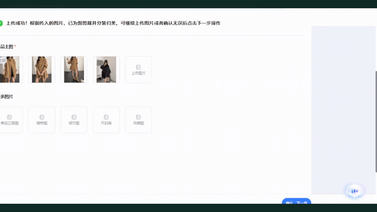

# Yundian AI · E-commerce Automation for Windows

[简体中文](README.md) · [English](README.en.md)

Yundian AI brings product asset preparation, AI content generation, bulk listings, and listing updates into one Windows app. Start with your product images, videos, and SKU data, then let the app fill fields, upload assets, and submit products according to your task settings.

**The free plan costs ¥0 per term and includes access to all product features. Usage quotas vary by plan. See your Account Center for current limits.**

**[Download for Windows](https://www.ai-yundian.com/download)** · [Release notes](releases/v1.0.7.md#english) · [Video guides in Chinese](https://www.ai-yundian.com/tutorials)

## Watch a product listing in action

[Download the full 37-second demo (MP4)](https://github.com/zhou293130/yundian-ai-downloads/raw/refs/heads/main/media/listing-demo.mp4). The app loads product images, fills in the title and attributes, uploads images and video, enters SKU details, submits the listing to the marketplace's product inventory, and moves on to the next item. The recording is edited and sped up.

## What you can do

| Workflow | What you can do |
| --- | --- |
| Listings and catalog updates | List products from local files on Taobao, Tmall, and Douyin Shop, update existing products in bulk, and edit or publish products from the Miaoshou fully managed TikTok Shop collection inbox. |
| AI titles, images, and product details | Generate listing titles and short titles. Create main images, white-background images, studio-style photography, and full product detail pages. |
| AI video and batch editing | Generate scripts, voiceovers, and captions. Edit batches of product videos or create clips using references, start and end frames, or templates. |
| Store operations and publishing | Upload assets for search and recommendations, collect trending terms, submit eligible products for marketplace opportunities, and publish videos through supported workflows. |
| Asset and catalog tools | Crop images, extract video frames, organize product files and spreadsheets, replace images, and upload or link videos in bulk. |
| Product sourcing | Organize supplier materials from Xingzuo, Xingqinglian, and Soukuan, then move from selection to asset collection and distribution. |
| Yundian Agent and MCP | Give instructions in plain language, prepare materials, invoke available tools, and track results. |

[View detailed features](FEATURES.en.md)

## Download and activate the free plan

1. Open the [official download page](https://www.ai-yundian.com/download) and choose **百度网盘免费下载** (free download via Baidu Netdisk). The page lists the access code and installation instructions.
2. Install the Windows app, create a Yundian AI account, and sign in.
3. Activate the **¥0 free plan** in the Account Center. The default term is 30 days, and you can claim another term after expiry. Check your Account Center for product processing and AI generation quotas.

[Official site](https://www.ai-yundian.com/) · [Plans](https://www.ai-yundian.com/pricing) · [Documentation in Chinese](https://www.ai-yundian.com/docs)

Yundian AI is proprietary software. This repository provides official download links and user documentation. Use of the software is governed by the license terms displayed during installation.
