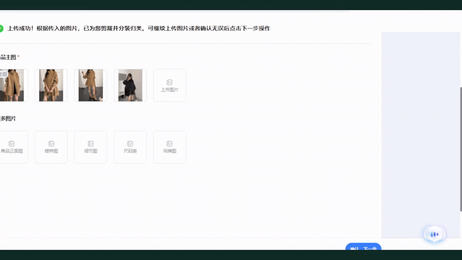
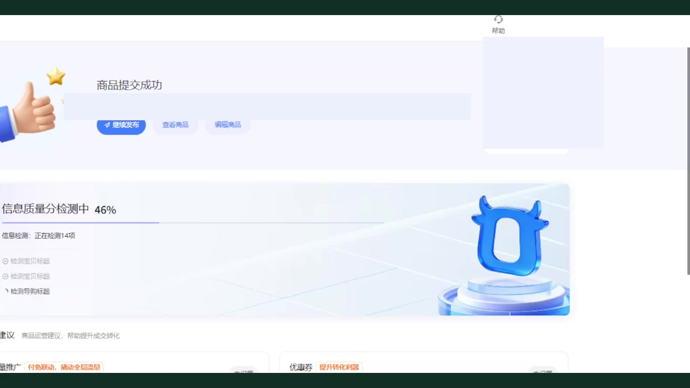

# 云店AI · 淘宝、天猫、抖店自动上架与商品批量编辑

[简体中文](README.md) · [English](README.en.md)

云店AI（Yundian AI）是面向电商卖家的 Windows 软件。淘宝自动上架、天猫批量上新和抖店批量上架都可以从本地商品文件夹开始。准备好图片、视频和 SKU 表后，软件按设置逐款填写标题和属性、上传素材并提交。店里已经有的商品，也可以批量改标题、换主图和更新详情。

**每期 0 元免费版，功能权限齐全。各套餐的使用额度不同，具体额度以账号中心显示为准。**

**[免费下载 Windows 客户端](https://www.ai-yundian.com/download)** · [查看版本更新](releases/v1.0.7.md) · [使用教程](https://www.ai-yundian.com/tutorials)

## 看一款商品怎么上架

[下载 37 秒完整演示（MP4）](https://github.com/zhou293130/yundian-ai-downloads/raw/refs/heads/main/media/listing-demo.mp4)。读取商品图片 → 填写标题和属性 → 上传图片和视频 → 填写 SKU → 提交至商品仓库 → 继续下一款。录屏经剪辑和快进。

## 可以做什么

| 场景 | 能做什么 |
| --- | --- |
| 商品自动上架 | 在淘宝、天猫、抖店使用本地素材批量上新，也支持妙手 TK 全托管采集箱编辑发布。 |
| 商品批量编辑 | 批量改宝贝标题、补属性、换主图和详情图，按平台支持范围更新 SKU、价格和库存。 |
| AI 电商生图与详情页制作 | 批量生成商品标题、主图、白底图、模特商拍图和整套商品详情页。 |
| 电商短视频批量混剪 | 自动制作口播文案、配音和字幕，按款混剪，也可用参考视频、首尾帧或模板制作。 |
| 淘宝、抖店运营 | 上传搜推素材、采集趋势词、报名商机，按平台对应流程发布视频。 |
| 电商素材批量处理 | 批量裁剪图片、从视频抽帧、整理商品文件夹和表格、上传及关联商品视频。 |
| 货源选款与批量铺货 | 从星座网、星轻链、搜款网整理货源资料，衔接选款、素材采集和铺货。 |
| 云店 Agent 与 MCP | 用自然语言准备资料、调用已开放的云店工具，并跟进任务结果。 |

[查看详细功能](FEATURES.md) · [淘宝自动上架使用说明](https://www.ai-yundian.com/solutions/taobao-automation)

## Windows 软件下载与免费版领取

1. 打开[官方下载中心](https://www.ai-yundian.com/download)，选择「百度网盘免费下载」。下载页有提取码和安装说明。
2. 安装 Windows 客户端，注册并登录云店 AI 账号。
3. 在账号中心领取 **0 元免费版**。默认每期 30 天，到期后可再次领取。商品处理量、AI 生成等可用额度请查看账号中心。

[官方网站](https://www.ai-yundian.com/) · [价格与套餐](https://www.ai-yundian.com/pricing) · [文档与排错](https://www.ai-yundian.com/docs)

云店 AI 是专有软件，发布仓库提供官方获取入口和使用资料。软件使用遵循安装时显示的许可条款。
