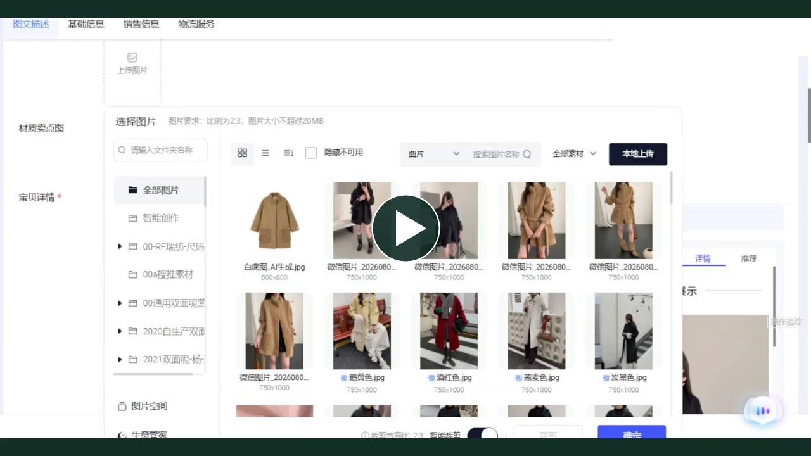
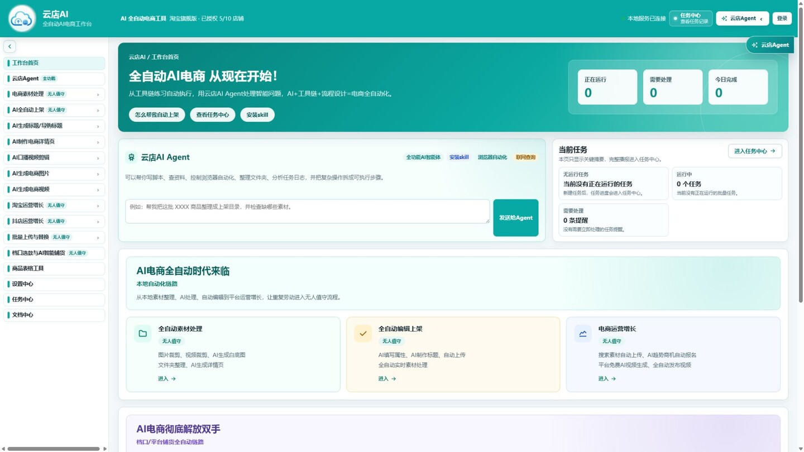

# 云店 AI · 电商自动化工作台

[简体中文](README.md) · [English](README.en.md)

云店 AI 是一款 Windows 电商自动化软件。它把商品素材整理、AI 内容制作、批量上架和已有商品编辑放在同一个工作台。准备好图片、视频和规格资料后，就能按任务设置逐款填写、上传和提交。

**每期 0 元免费版，功能权限齐全。各套餐的使用额度不同，具体额度以账号中心显示为准。**

**[下载 Windows 客户端](https://www.ai-yundian.com/download)** · [查看版本更新](releases/v1.0.7.md) · [使用教程](https://www.ai-yundian.com/tutorials)

## 看一款商品怎么上架

[打开演示视频](media/listing-demo.mp4)。读取商品图片 → 填写标题和属性 → 上传图片和视频 → 填写 SKU → 提交至商品仓库 → 继续下一款。录屏经剪辑和快进。

## 可以做什么

- **批量上架和编辑商品** · 按对应平台能力处理淘宝、天猫、抖店的商品资料、图片、视频和 SKU。
- **用 AI 准备商品内容** · 生成商品标题、主图、详情内容和视频，成品可进入支持的上架与编辑流程。
- **安排和跟进任务** · 保存常用设置，在任务中心查看进度、处理结果和失败原因。

## 下载并领取免费版

1. 打开[官方下载中心](https://www.ai-yundian.com/download)，选择「百度网盘免费下载」。下载页有提取码和安装说明。
2. 安装 Windows 客户端，注册并登录云店 AI 账号。
3. 在账号中心领取 **0 元免费版**。默认每期 30 天，到期后可再次领取。商品处理量、AI 生成等可用额度请查看账号中心。

[官方网站](https://www.ai-yundian.com/) · [价格与套餐](https://www.ai-yundian.com/pricing) · [文档与排错](https://www.ai-yundian.com/docs)

云店 AI 是专有软件，发布仓库提供官方获取入口和使用资料。软件使用遵循安装时显示的许可条款。
